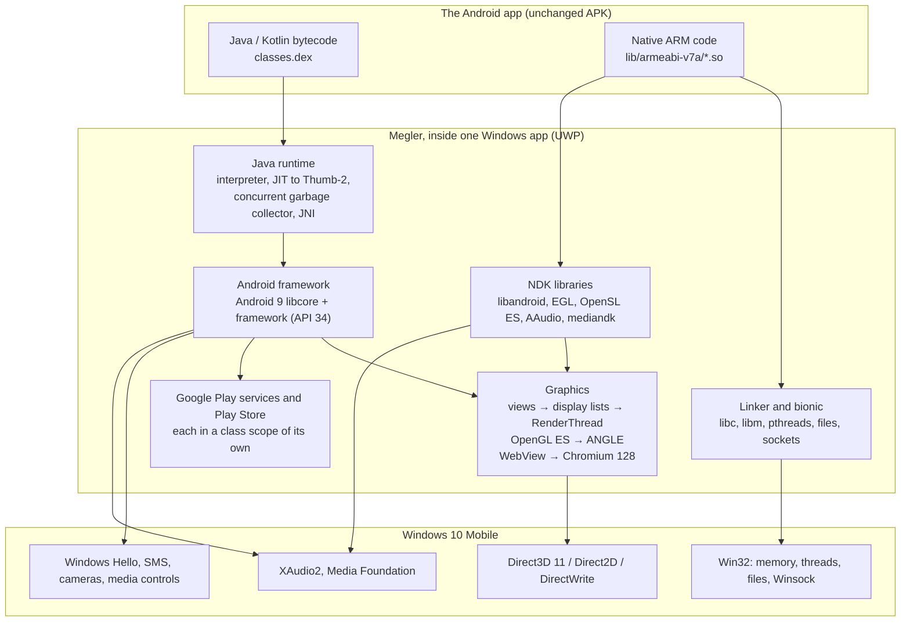
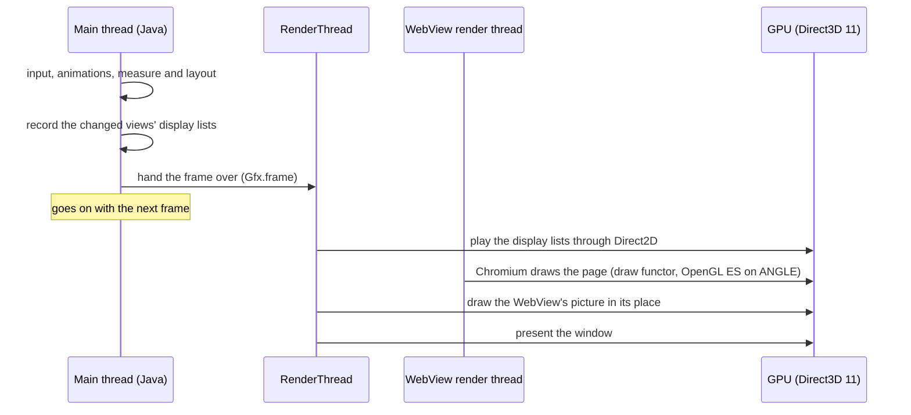

# Megler

**Android apps on Windows 10 Mobile.** Megler runs an Android app's own code directly on
the phone's ARM processor, inside an ordinary Windows app. Nothing is emulated and no
Android system boots: Megler stands in for Android around the app -- its linker and C
library, its Java runtime and framework, its graphics, its sound, its Google services --
and answers each call with Windows' own.

It runs on the Windows 10 Mobile builds phones have today (1703, 10.0.15063, and later;
developed on an HP Elite x3, 10.0.15254). [docs/STATUS.md](docs/STATUS.md) says exactly
what has been seen working and where; [docs/ARCHITECTURE.md](docs/ARCHITECTURE.md) and
[docs/JAVA.md](docs/JAVA.md) say how it works.

**Download: [the latest release](https://github.com/Computershik73/megler-w10m/releases/latest).**
Its `Megler_<version>_ARM.appx` has everything a phone needs, Google Play Store, Google
Play services and microG included; install `Megler.cer` from the same page first. The
release notes say how to install it.

## What it does today

- **Google Play.** The official Google Play Store and Google Play services run in Megler.
  You sign in with a Google account, find an app, and Play downloads and installs it. The
  Gosuslugi app, installed this way, signs in and keeps its sign-in across starts.
- **Apps written in Java and Kotlin, and native games.** Spotify, Telegram, Yandex Maps,
  Gosuslugi and others start and are used on the phone; games built on NativeActivity or
  Unity (IL2CPP) run with their sound and films. Each app has its own state of
  compatibility (STATUS.md), and some still end with errors that are being fixed.
- **A modern WebView.** Android's System WebView, Chromium 128, runs inside the app, and
  draws its pages on the graphics processor.
- **The phone's own hardware and services.** Windows Hello answers Android's
  `BiometricPrompt`; text messages reach apps that wait for a code; cameras, media
  controls on the lock screen, H.264/H.265/AAC/MP3 decoding by Media Foundation, the
  phone's folders as `/sdcard`.
- **Apps installed one by one.** An APK, `.apks` or `.xapk` opened on the phone, or an
  app from Google Play, can become a Windows app of its own (`MeglerApp.<package>`): its
  own tile, its own process and memory, its own entry in the task switcher.

## How it works

An APK holds two kinds of code: Java bytecode (`classes.dex`) and native ARM libraries
(`lib/armeabi-v7a/*.so`). Megler runs both on the phone's processor and puts a piece of
its own wherever Android would have put a piece of the system:



What stands where Android would stand:

| Android has | Megler has |
|---|---|
| The Linux kernel and bionic, Android's C library | bionic written over Win32 inside the app: files, threads and futexes (`WaitOnAddress`), memory (`VirtualAlloc`), sockets (Winsock), signals |
| The dynamic linker | its own linker: loads `armeabi-v7a` libraries straight out of the APK, relocates them, and rewrites the few instructions Windows does not allow an app (reading the thread pointer, ARM-mode PLT entries) |
| ART, Android's Java runtime | its own Dalvik runtime: an interpreter, a method JIT to Thumb-2 on code pages that are writable and executable at once where the phone allows it, a concurrent garbage collector, JNI |
| libcore and the framework | Android 9's libcore with its native libraries built for ARMv7, and an Android framework that answers as API 34 (Android 14) |
| HWUI and SurfaceFlinger | views record display lists; a RenderThread plays them through Direct2D on the graphics processor; OpenGL ES runs on ANGLE over Direct3D 11; frames of a `TextureView`, a `SurfaceView` and the WebView stay on the graphics processor as shared Direct3D textures |
| Separate processes and Binder | an app's other processes (`android:process`) as class scopes of its own APK, with their own statics and Application; Google Play services as a scope of its own |
| The package manager and installer | Megler's library: APK, `.apks`, `.xapk`, and Google Play's `PackageInstaller` sessions; an app can be its own Windows package |
| The keystore, biometrics, telephony, media | an `AndroidKeyStore` provider kept in the app's data; Windows Hello; the phone's message store; XAudio2, Media Foundation, `Windows.Media.Capture`, the system media controls |

A frame of a Java app is made the way Android makes it, on two threads:



Why it is fast:

- **No emulation.** Native libraries and the JIT's code run on the phone's own
  processor, at its full speed.
- **Everything is drawn on the graphics processor.** Views, text, bitmaps, OpenGL ES, video
  and the WebView all go through Direct3D; nothing is read back to the processor to be
  shown.
- **The main thread does what Android's does.** Drawing and presenting happen on a
  RenderThread, as on Android, so input and layout are not held up by the screen.
- **Hot Java code is compiled.** Methods are compiled to Thumb-2 as they get hot, small
  ones inlined, and the garbage collector marks and sweeps alongside the app.

## Megler and Project Astoria

Project Astoria ("Windows Bridge for Android") was Microsoft's own way of running Android
apps on Windows 10 Mobile. It was announced at Build 2015, appeared in Windows 10 Mobile
Insider builds of 2015, was taken out of them, and was cancelled in February 2016. It
put a Linux-compatible subsystem into Windows itself (the work later became the Windows
Subsystem for Linux) and ran an Android 4.4 system on it.

| | Project Astoria (2015) | Megler |
|---|---|---|
| Today | cancelled; only in old Insider builds | developed; runs on the builds phones have now (1703 and later) |
| What it is | a subsystem built into Windows | an ordinary Windows app (developer mode and an interop unlock for code generation) |
| Android | 4.4 KitKat (API 19) | Android 9's libcore, a framework that answers as API 34 |
| Google Play services and Play Store | none: apps were to be changed to use Microsoft's services | the official ones; apps are installed from Google Play |
| WebView | KitKat's | Chromium 128, drawn on the graphics processor |
| Getting an app | sideloaded from a PC with adb | an APK, `.apks` or `.xapk` opened on the phone, or Google Play |
| An app on the phone | inside the Android system | a Windows app of its own if you want: its tile, its process, its task-switcher entry |
| Phones | a few Lumia models | any Windows 10 Mobile ARM phone |
| The phone's features | -- | Windows Hello, text messages, cameras, lock-screen media controls, hardware video decoding |
| Source | closed | open (GPL-3.0) |

In short: Astoria needed Microsoft's operating system to carry Android and was never
finished. Megler asks the system for no more than developer mode and an interop unlock,
runs today's apps with Google's own services, and keeps improving.

What Megler cannot do (yet): run APKs that have only 64-bit (`arm64-v8a`) code -- Windows
10 Mobile is 32-bit on every phone; use Vulkan; give an app more than the 2 GB of
addresses a 32-bit process has. Each app's own state is in [docs/STATUS.md](docs/STATUS.md).

## Layout

```
core/             the layer, portable C11
  include/megler.h  what the shell sees
  src/host/       the OS (Win32 app container; POSIX for the tests)
  src/ld/ arm/    the dynamic linker; what is rewritten in guest code
  src/bionic/     libc, libm, libdl, liblog, pthreads, files, the network
  src/ndk/ jni/   libandroid, EGL/GLES over ANGLE, AAudio, OpenSL ES, mediandk; JNI
  src/dvm/        the Java runtime: interpreter, JIT, garbage collector (docs/JAVA.md, docs/JIT.md)
  src/drivers/    the Java side of each kind of app: graphics, GL, WebView, media, camera
  src/apk/ zip/   APKs, manifests, resources
  framework/      the Java framework; framework-overlay/ what Megler changes in it
  tests/          the tests, and guest/ and app/: Android libraries and apps for them
app/Megler/       the C++/WinRT shell: library, player, Direct2D drawing, sound, codecs
tools/            build-appx.sh, build-tests.sh, build-framework.sh, phone.py
docs/             ARCHITECTURE.md, STATUS.md, JAVA.md, JIT.md, MICROG.md, PER-APP-PACKAGES.md
```

## Build

Requirements: Visual Studio 2022 17.14 (MSVC 14.44 with the ARM build tools),
Windows SDK 10.0.22621 (headers, tools) and 10.0.15063 (ARM libraries), LLVM (clang
and ld.lld, for the guest test libraries), Git Bash, Python 3, a JDK and the Android
SDK's d8 (for the framework). For the tests that execute Android code: WSL Ubuntu with
`gcc-arm-linux-gnueabihf` and `qemu-user`. ANGLE comes from a
[gecko-w10m](https://github.com/Computershik73/gecko-w10m) build (`C:\rw-obj\dist\bin`,
or `MEGLER_ANGLE`).

```bash
bash tools/build-guest.sh          # the Android test libraries and apps (clang, no NDK)
bash tools/build-tests.sh arm      # the core's tests under qemu-arm: guest code really runs
bash tools/build-framework.sh      # the Java framework
bash tools/dvm-android-root.sh     # the Android root: libcore, the framework, fonts, the WebView
bash tools/build-appx.sh arm --java # → app/Megler/AppPackages/Megler_<ver>_ARM.appx
```

## On the phone

The phone must be interop-unlocked (for `codeGeneration`), in Developer mode, and
trust the package's certificate (`AppPackages/Megler.cer`). A package you do not build
yourself is on [the latest release](https://github.com/Computershik73/megler-w10m/releases/latest),
with its `Megler.cer`.

The first time, install the package from a PC through the phone's Device Portal
(`python tools/phone.py install`), or open it in the phone's file manager, which hands it
to Windows's App Installer. After that Megler updates itself: from GitHub (Settings ›
Updates), or from a newer package copied with its `Megler.cer` into the phone's
`Pictures\Megler` folder, which it installs when it starts. Megler installs its updates and
the apps' packages through Windows's deployment engine and asks the Device Portal nothing:
the portal need not be on for it, nor its authentication off. Then, in Megler:

1. **Add APK** (or open an APK, `.apks` or `.xapk` from the phone's file manager), or open
   Google Play from the library and install from there.
2. **Play**, or make the app a Windows app of its own and start it from its tile.
3. **Update All** after Megler itself is updated: each app's own package is rebuilt.

**Device › Probe** and **Device › Self-test** check what this phone allows and run the
core's tests on it; the **Log** says what each app does.

## Author

Megler is made by Computershik. The Java framework in `core/framework` comes from
another project (GPL-2.0-or-later) and is licensed here under the GPL-3.0, as
[core/framework/NOTICE](core/framework/NOTICE) says.

- [Profile on 4pda](https://4pda.to/forum/index.php?showuser=4458524)
- [Telegram channel @cmplog](https://t.me/cmplog)
- [Donate](https://pay.cloudtips.ru/p/83821e32) (within the CIS for now; from
  outside the CIS, send a message to the Telegram channel)

## License

Megler is licensed under the GNU General Public License version 3 (LICENSE). The vendored zlib is under the zlib license; ANGLE is
BSD; Android's libcore and framework are under the Apache License 2.0.
